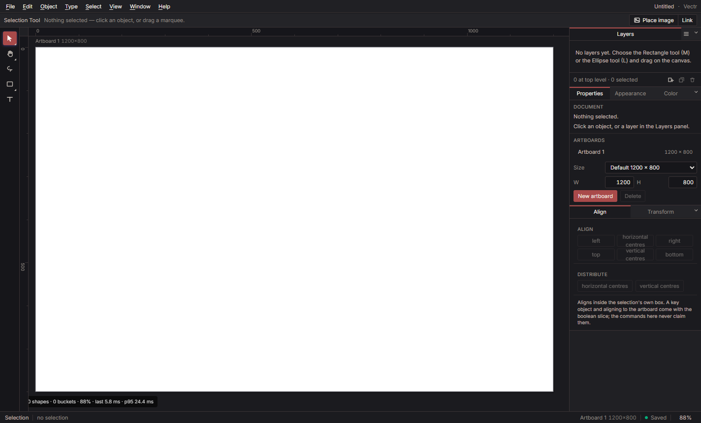

<div align="center">


# Vectr

**Draw like Illustrator. Ship React.**

A desktop-first vector design tool with Illustrator's conventions and its own compiler: every layer becomes a readable React component styled with Tailwind.

[](https://www.electronjs.org/)
[](https://react.dev)
[](https://www.typescriptlang.org/)
[](https://skia.org/)
[](https://tailwindcss.com/)
[](./LICENSE)
[](https://lleoparden.github.io/vectr/)
[](https://github.com/lleoparden/vectr/releases/tag/v0.4.1)

</div>

---

## What is Vectr?

Vectr is a vector illustration application, not a whiteboard. It is built the way a drawing tool has to be built: a versioned document with exact undo inverses, one validated command for every action, tools as state machines, and an interface that follows Illustrator wherever muscle memory matters — the menu bar, the left palette, the docked panels, the Layers panel as the document's spine, the shortcuts you already know.

What makes it different is where the drawing goes next. A layered Vectr document **compiles to React**: each layer becomes a component with a stable, readable name, groups compose children, and the styling lands in Tailwind — with the smallest honest CSS or SVG adjunct where Tailwind cannot express something. The compiler is the reason the editor is this strict about its document model.

Nothing is borrowed: the icons, type, colours, copy, and code are Vectr's own. Illustrator is followed as a convention, never copied as an asset.

## Features

- **Twelve tools, all state machines** — Selection and Direct Selection with their flyout, Lasso, seven shape tools, Type, Hand, and Zoom. Every tool takes pointer input, emits commands, and draws its own overlay; the canvas only routes.
- **Real transforms** — Move, eight-handle scale in the object's own frame, rotation about the centre with a 15° Shift snap, Alt-drag to duplicate, arrow-key nudging, and a rotated selection that still scales along its own sides.
- **Precision canvas** — Multiple artboards with size presets, rulers with re-stepping ticks, a grid under the artwork, and guides that snap, persist, and live in the file.
- **Paint that behaves** — Fills, strokes with caps, joins, dashes, and inside/centre/outside alignment; linear and radial gradients with up to eight stops painting fill, stroke, or both; all sixteen blend modes on fills and strokes; named swatches with CMYK and spot definitions.
- **Composition** — Vector clipping masks, isolation mode, nested groups, Arrange, Align and distribute, group/ungroup, duplicate, cut/copy/paste.
- **Type and images** — Point text with in-place editing and missing-font reporting; embedded and linked images, relink, non-destructive crop, and raster alpha masks.
- **Layers you can work in** — Reorder, rename, nest, lock and hide with inheritance, live thumbnails (nested rows either preview or say why not), a locate column for the group that owns the selection, and drag-into-group.
- **A live interface** — Hover outlines from the same hit test the tools use, per-tool cursors, a rotation readout while dragging, and scrub-able number fields that accept arithmetic (`120+30`).
- **Documents that hold** — A versioned native format with byte-stable saves, autosave for saved documents, crash recovery that restores the whole project folder with its images, and a close guard.
- **No dead controls** — A capability that is not built is not displayed; every shipped limitation is written down in the catalog and the decision record.

## Screenshots



<sub>The editor in its brand palette: charcoal chrome, rose accents, off-white text. Regenerate with <code>npx electron . --screenshot=site/screenshot.png</code>.</sub>

## Status

**Phase 4 is complete. Phase 5 — the Bézier path model — is next.**

| Area | State |
| --- | --- |
| Document, undo/redo, autosave, recovery | Shipped, 272 tests |
| Tools, transforms, rotation, zoom | Shipped, all twelve as state machines |
| Paint: fills, strokes, gradients, blends, swatches | Shipped (no mesh, patterns, or width profiles yet) |
| Artboards, rulers, grid, guides | Shipped (no page reordering) |
| Text | Point text only — area, path, and threaded text are Phase 6 |
| File interchange | Native format only — SVG, PDF, and `.ai` are Phase 8 |
| React + Tailwind compiler | Phase 10 |
| macOS / Linux | Phase 9 |

Feature by feature, including what is deliberately not built: [**docs/AUDIT.md**](docs/AUDIT.md).

Releases are [here](https://github.com/lleoparden/vectr/releases), one per phase and each with its own
installer; the notes come from [`docs/RELEASES.md`](docs/RELEASES.md) and a tag never moves.

## Tech stack

| Layer | Technology |
| --- | --- |
| Shell | Electron 35, a preload bridge, and Vectr's own window chrome |
| Interface | React 19, Tailwind CSS 4, Vite 6, TypeScript 5.7 |
| Renderer | CanvasKit (Skia) with recorded pictures and per-root buckets |
| Document | Pure TypeScript: typed nodes, commands with exact inverses, bounded history |
| Files | Content-addressed project folders, canonical JSON manifests, atomic writes |
| Tests | `node:test` with type stripping, plus a packaged Electron evidence run |

## How it is built

The codebase follows a strict layering, enforced by `scripts/check-layers.mjs` on every test run — a module may only import from a lower layer.

```
L0  src/geom/          curves, transforms, colour, CMYK, viewport maths
L1  src/doc/           document model, commands, history, validation, hit testing
L2  src/ops/           path operations (Phase 5)
L3  src/render/        renderer and scene builder        src/file/  native format, recovery
L4  src/tools/         tools as state machines
L5  src/state/  src/app/commands/  src/app/editing/      stores, registry, pure editing rules
L6  src/app/           shell, canvas host, panels, the component kit
L7  electron/  src/dev/  src/bench/  scripts/            shells, harnesses, tooling
```

The interface is a component kit in `src/app/ui/components/`: one button, one numeric field, one menu row, one tab, one empty state, one swatch tile, one tool slot. `tests/uiStandards.test.ts` fails on any hand-written `<button>` or `type="number"` anywhere outside it.

## Getting started

**Install on Windows:** download `Vectr-<version>-Setup.exe` from the
[latest release](https://github.com/lleoparden/vectr/releases). The installer is unsigned, so
SmartScreen warns once and the release notes explain it; it is rebuilt at every phase close.

**Run from source:** Node.js 22+ and npm. Windows is the reference platform today.

```bash
npm install
npm start             # build and launch the desktop editor
npm run package:win   # optional: build the installer into release/
```

## Verify it

```bash
npm run typecheck    # tsc --noEmit
npm test             # 272 unit tests + layer rule + UI standards
npm run build        # vite build
npm run smoke        # packaged evidence: 149 steps across seven reports
```

`npm run smoke` launches the packaged app and drives it with real input — text editing, undo, recovery, hit testing, the wheel, a rotation drag, the panels. If it fails with `Cannot read properties of undefined (reading 'whenReady')`, the shell has `ELECTRON_RUN_AS_NODE=1` set; clear it for the run (`$env:ELECTRON_RUN_AS_NODE=''` in PowerShell) — that is not a Vectr bug.

`npm run benchmark` re-packages the app to re-measure the renderer; it is only needed when renderer budgets are being recorded again.

## Roadmap to the compiler

| Phase | What it adds |
| --- | --- |
| **5** | Bézier paths, the Pen, anchor editing, Pathfinder and Shape Builder, width profiles, compound paths |
| **6** | Type: area, on a path, threaded, character and paragraph styles |
| **7** | Appearance stacks, transparency groups, effects, brushes, patterns, symbols |
| **8** | SVG, PDF, and Illustrator file interchange with a published fidelity matrix |
| **9** | Core parity gate: hardening, macOS and Linux, performance budgets, accessibility |
| **10** | **The React + Tailwind compiler** |
| 11–13 | MCP for account-scoped agents, cloud and collaboration, further expansion |

The phase-by-phase plan with exit criteria is [**docs/MASTER_PLAN.md**](docs/MASTER_PLAN.md); the slice checklist is [**docs/PLAN.md**](docs/PLAN.md).

## Documentation

| Document | What it answers |
| --- | --- |
| [docs/PLAN.md](docs/PLAN.md) | What is being worked on now |
| [docs/PROGRESS.md](docs/PROGRESS.md) | What shipped, with the evidence for it |
| [docs/AUDIT.md](docs/AUDIT.md) | Feature by feature: built, partial, or missing |
| [docs/DECISIONS.md](docs/DECISIONS.md) | Why the settled choices are settled |
| [docs/PARITY_CATALOG.md](docs/PARITY_CATALOG.md) | The capability catalogue and its status rules |
| [docs/PARITY_ROADMAP.md](docs/PARITY_ROADMAP.md) | The reference architecture and the ranked gap list |
| [docs/MASTER_PLAN.md](docs/MASTER_PLAN.md) | Every phase, in order, with exit criteria |
| [CONTRIBUTING.md](CONTRIBUTING.md) | How to set up, test, and land a change |
| [AGENTS.md](AGENTS.md) | The binding rulebook behind the contribution guide |

## Contributing

Read [`AGENTS.md`](AGENTS.md) first. Every change starts on its own branch, ships with typecheck, the full suite, a build, and packaged evidence where a user can see it, and states in its pull request which layer it touches, which rule it respects, what it deliberately leaves out, and its residual doubt.

## License

MIT — see [`LICENSE`](./LICENSE).
